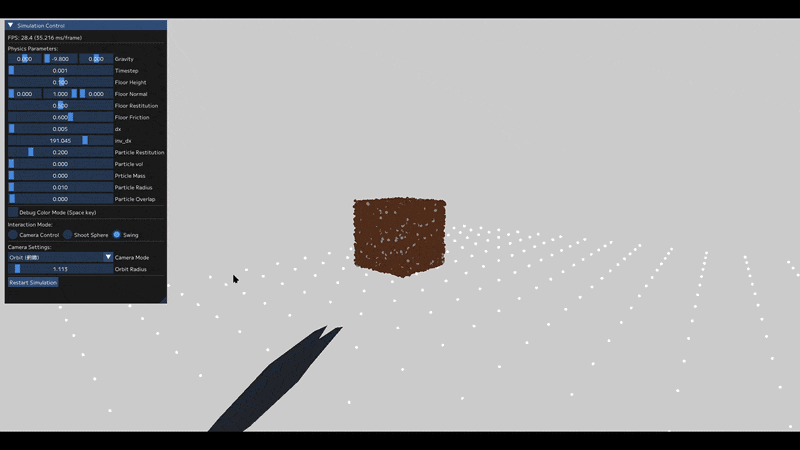

# MPM Sand Simulation

OpenGLのコンピュートシェーダーで砂の落下・堆積と、動く障害物との接触を計算する研究用シミュレーターです。格子の保存方式と粒子・格子間の補間方式を個別に選べます。

## 現行バージョン(2026/11/19時点)
指導教員からのコードレビューと以前からの物理式の不整合などについて修正作業を実施しています。
 - SDFの面構成を改善しました。最近接面までの距離でなく「巻き数(winding number)」を用いた方式に変更しました。
 - SVDの計算における符号間違いなど物理式の整合性チェック及び修正を行いました。
 - SSBO方式の2次Bスプライン補間での計算処理をシミュレーションと接続しました。

## デモ

開発時に収録した操作例です。現行版の方式比較と性能評価は条件を揃えた試験として扱います。現行版の性能値は掲載保留です。

## 機能

- 格子保存は3DテクスチャまたはSSBO、補間は2次Bスプラインまたは線形。計4通りを選択できます。
- OBJメッシュから符号付き距離場（SDF）を生成し、障害物をShootやSwingで操作できます。直前の操作も再実行できます。Shootで発射した障害物は床や格子端に当たるまで等速で直進します。衝突後は重力が働き、床で軽く跳ねて摩擦で減速します。
- Points、Spheres、Surface、Splatの描画方式と、粒子の状態を表示するDebug Colorを選べます。
- 履歴から粒子と障害物の状態を復元できます。GPUパス時間、粒子状態、アプリFPSなどは設定に応じて記録し、CSVへ出力できます。

## ビルドと起動

WindowsでVisual Studio 2022（C++デスクトップ開発、v143）と、OpenGL 4.3以上に対応するGPU・ドライバーを使用します。GLEW、GLFW、GLMはNuGet依存関係です。

1. `GPUMPMTex3D.sln` を開き、NuGet依存関係を復元して `Debug | x64` または `Release | x64` でビルドします。
2. 実行時の作業ディレクトリをリポジトリのルートにします。シェーダー、`src/assets/object.obj`、`ImGui/Mplus1-Regular.ttf` を相対パスで読みます。Visual Studioはプロジェクトディレクトリから起動します。OBJがない場合は組み込み球を使います。独自の障害物は向きが整った閉曲面の三角形メッシュとして配置し、OBJがMTLを参照する場合は同じディレクトリに置きます。
3. 起動コンソールでメモリ方式（`0` = 3D Texture、`1` = SSBO）と補間（`0` = Quadratic B-Spline、`1` = Linear）を選びます。基準方式は `0` → `0` です。画面の **Play** または **Step Forward** で計算を進めます。

既定は1万粒子、128³格子、1ステップ0.25 msです。**Sub-steps** は1描画フレームで行う計算回数を変更します。各ステップの刻みは固定です。**Restart Simulation** は現在の設定で初期状態に戻します。保存方式・補間・粒子数・格子を変更する場合は **Apply & Restart Simulation** を使います。入力やGPU資源の検証でエラーが出た場合は、適用前のシミュレーションと履歴から操作を続けられます。

## ドキュメント

- [ソース構成](docs/architecture.md) — ファイルの配置と役割
- [実装詳細](docs/implementation.md) — 起動・再構築、GPUの計算パス、SDF接触、履歴と評価
- [問題と修正の記録](docs/issues_and_fixes.md) — 旧版で観察した問題、修正と確認範囲
